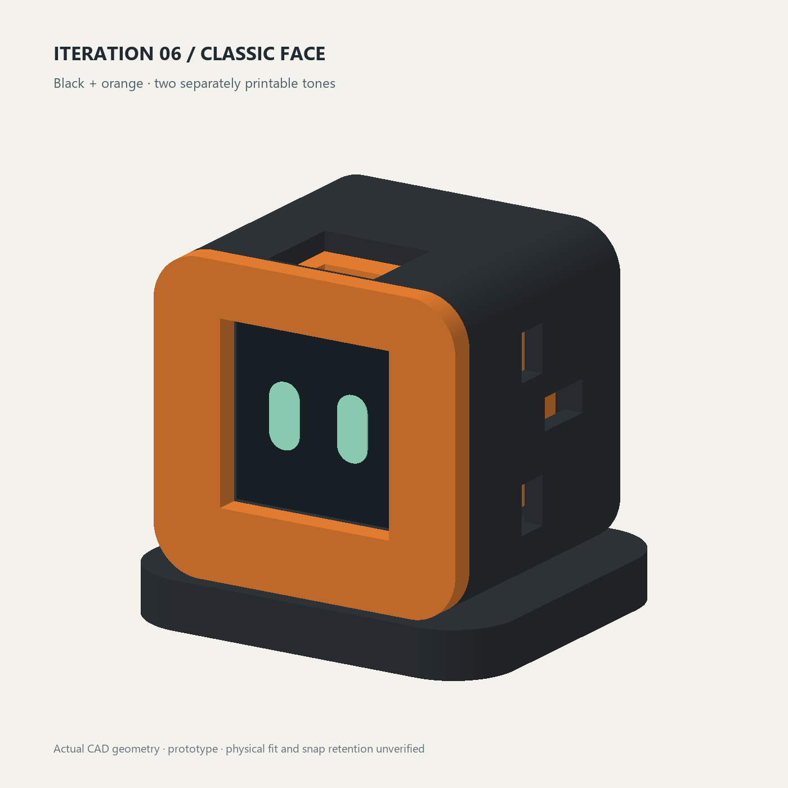

# AtomS3R + Echo Base Codex companion

An M5 Atom desk avatar for Codex activity, with animated eyes, speaker cues and a screwless snap-fit enclosure.

[Live expressions and cute voice](https://atom-expression-lab-shree-1029.plumtrail2049.chatgpt.site) · [Step-by-step build guide](GETTING_STARTED.md) · [Online guide and downloads](https://atom-expression-lab-shree-1029.plumtrail2049.chatgpt.site/setup.html)



The browser preview includes continuously moving Working eyes, a pulsing Needs you prompt, a bouncing New message envelope and bundled prerecorded character voices. A selector offers Cute, Bright/anime-like, Warm, Mature and a spoken announcer. The current hardware target is AtomS3R C126 with the Atomic Echo Base A149. The Arduino CLI build embeds the default Cute recordings and updated active faces; the website retains all five voice styles for comparison. See [Arduino build and device diagnostics](firmware/ARDUINO.md).

## Project layout

| Folder | Purpose |
| --- | --- |
| `companion/`, `hooks/` | Laptop observer, authenticated local events, USB transport and Codex hook example |
| `firmware/` | PlatformIO device firmware, screen, speaker and button |
| `preview/`, `expressions/` | Browser face/voice preview and editable expression definitions |
| `cad/` | Parametric CAD source and STL/STEP/3MF model exports |
| `outputs/` | Release firmware application images |
| `tests/`, `checks/` | Tests, acceptance limits and packaging scripts |

## Try the preview locally

```sh
python -m http.server 8000 --directory preview
```

Open http://localhost:8000 and click **Sound on**. To include local download links, first run `python checks/build_downloads.py`, then serve `sites/atom-expression-lab/dist` instead of `preview`. This generates the static guide and downloads from the included source and models. The browser preview does not communicate with the device.

The preview plays bundled CC0 recordings from cicifyre and Kenney. Character styles use vocal reactions, while the announcer uses ready-made words. Bright/anime-like is a pitch variation, not a recording from an anime. See [audio credits](preview/voices/CREDITS.md). Installing Python packages, the pinned firmware toolchain and CAD dependencies requires network access. Runtime observer traffic uses laptop loopback and USB. Credentials and local runtime configuration are excluded from this repository. No reuse license has been selected.

Start with [GETTING_STARTED.md](GETTING_STARTED.md) for the complete Windows/macOS setup sequence. The browser preview uses recorded voices and revised animations; the S3R firmware embeds the default Cute recordings.

A small physical Codex avatar with eight expressions, quiet attention sounds and a pressable face. V1 has **no motors or motor control**. Motion is reserved for V2.

**Selected design: A — Classic, orange bezel + black body**, chosen by the user on 2026-10-29. Softer/slimmer alternatives are retained only as design studies.

The user's colour-screen M5 Atom and reported built-in speaker are the intended hardware. The current Arduino CLI profile targets **AtomS3R C126 + Atomic Echo Base A149**. The older AtomS3 C123 binary is a legacy reference. Firmware uses `M5.Display`, `M5.BtnA` and `M5.Speaker`, letting the M5 library own the hardware drivers. The Echo Base microphone supports an explicit local level diagnostic; no external voice service is used.

## What is implemented

- Local Python observer with authenticated loopback ingress and explicit USB port selection.
- Per-session state priority, request acknowledgement, stale-turn filtering, bounded framing and reconnect without replaying cues.
- Eight faces: idle, working, needs input, new message, finished turn, error, interrupted and disconnected.
- Device speaker cues use embedded CC0 Cute recordings. Input/error reactions repeat while active; message/completion repeat three times. Acknowledgement, mute, state changes and disconnection stop playback. The microphone runs only for an explicit local level diagnostic.
- Short face press acknowledges the displayed alert; it **never approves a Codex operation**. Long press toggles sound mute, saved on the device.
- Nominal stationary enclosure, fit coupons, assembly and exploded views. Maximum two printed colours; all parts can also use one colour.

## Install and run the laptop companion

From this directory on Windows:

```powershell
uv venv --python 3.13 .venv
uv pip install --python .venv\Scripts\python.exe -r requirements-dev.txt
.venv\Scripts\python.exe -m companion.main --init-config
.venv\Scripts\python.exe -m companion.main --port COM5
```

Replace COM5 with the actual device port. The private config defaults to `~/.atom-companion/config.json`. Initial setup refuses to overwrite an existing config and restricts token-file access. For observation without a connected device, use `--dry-run` instead of `--port`.

For an explicit manual demonstration from another terminal:

```powershell
.venv\Scripts\python.exe -m companion.main --emit start
.venv\Scripts\python.exe -m companion.main --emit needs_input
.venv\Scripts\python.exe -m companion.main --emit finished
```

These are manual demonstrations, not proof that Codex events are connected.

## Codex observer integration

`companion/hook.py` accepts supported Codex hook JSON on stdin and emits no stdout or approval decisions. It hashes session/turn/request identities and forwards status metadata only; prompts, tool arguments, transcript contents and source code do not leave the hook. Network forwarding times out after 0.2 seconds and failures do not fail the Codex hook.

Use `hooks/observe.py` as the absolute script entry point, with the absolute path to this project's Python interpreter. It works when Codex is running in a different project directory. `hooks/config.example.json` is a merge fragment; preserve your existing hooks. Existing global hooks have **not** been overwritten or enabled by this project.

Documented event mappings and limitations are in [checks/event-coverage.md](checks/event-coverage.md). Live coverage on the user's exact Codex app version is still to be demonstrated. Hook-invocation timestamps improve delivery ordering but are not an authoritative ordering API for the entire Codex application. No transcript scraping is used.

## Current AtomS3R firmware build and upload

Follow [firmware/ARDUINO.md](firmware/ARDUINO.md) for Arduino CLI installation, the official S3R board package, upload, and local speaker/microphone checks.

```sh
python checks/arduino_build.py
python checks/arduino_build.py --upload --port COM5
```

The following PlatformIO route is retained for development and needs separate qualification; the Arduino CLI route is the current hardware target.

## PlatformIO development route

```powershell
$env:PLATFORMIO_CORE_DIR = Join-Path (Get-Location) '.pio-core'
.venv\Scripts\platformio.exe run -d firmware -e atoms3r_echo -j 2
# Only after confirming board identity and the actual port:
.venv\Scripts\platformio.exe run -d firmware -e atoms3r_echo -t upload --upload-port COM5
```

Do not flash a different Atom variant with this profile. The AtomS3R + Echo Base Arduino build was uploaded on 2026-10-30. Live protocol, speaker-driver playback and local microphone capture checks passed; see [the hardware check](checks/HARDWARE_S3R_ECHO.md). Actual display/sound quality and button feel require user confirmation.

## Enclosure and images

V1 source: [cad/stationary.py](cad/stationary.py). Nominal overall size: **48 × 42 × 44 mm**. Printed parts: black body/foot, orange bezel, black rear keeper. One-colour printing works without changing geometry. Each part prints separately; a multicolour printer is unnecessary.

Print fit coupons before a full enclosure. Start with 0.2 mm layers and a 0.4 mm nozzle, then adjust fit for the actual machine and material. Do not assume PLA and ABS yield the same snap clearance. The screen aperture must leave the real button free of preload; USB connector and sound grille locations need checking against the exact variant. Snap fits and the board keeper remain prototype retention features until assembled and tested.

```powershell
& "$HOME\.local\bin\cadgen.cmd" +0.8.1 run cad\check_geometry.py
& "$HOME\.local\bin\cadgen.cmd" +0.8.1 run cad\exports.py
& "$HOME\.local\bin\cadgen.cmd" +0.8.1 run cad\render_mesh.py
.venv\Scripts\python.exe cad\render_cpu.py --iteration 2
.venv\Scripts\python.exe cad\render_cpu.py --iteration 2 --single
```

Text-to-CAD's native image backend failed OCCT pixel readback on this Windows setup. `render_mesh.py` exports the actual built surfaces and `render_cpu.py` renders them with a NumPy depth buffer and Pillow; images are geometry renders, not photographs or generated concept art. Rendering dependencies are in requirements-render.txt.

`cad/enclosure.py`, motor calibration headers and `firmware/test/test_limits` are earlier V2 explorations. They are not linked into V1 firmware, not V1 print deliverables, and not a complete motion mechanism.

## Verification

```powershell
.venv\Scripts\python.exe -m unittest discover -s tests -v
.venv\Scripts\python.exe checks\run_native.py
```

Current hardware results are in [checks/HARDWARE_S3R_ECHO.md](checks/HARDWARE_S3R_ECHO.md); earlier baseline results remain in [checks/ACCEPTANCE.md](checks/ACCEPTANCE.md). Close any serial monitor before upload or starting the companion; only one process can own the port. Stop the observer with Ctrl+C. Disconnect shows a disconnected face after five seconds. Reconnect resends current state without repeating old attention sounds.

To rebuild the prepared voice clips from their source ZIPs, use `python checks/prepare_voice_assets.py --archives PATH`; NumPy is required for that optional conversion. Sources and filenames are documented in the audio credits. Playback itself needs no NumPy or speech service.
